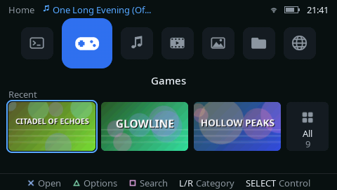
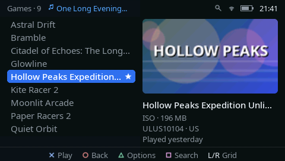
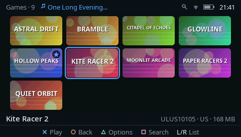
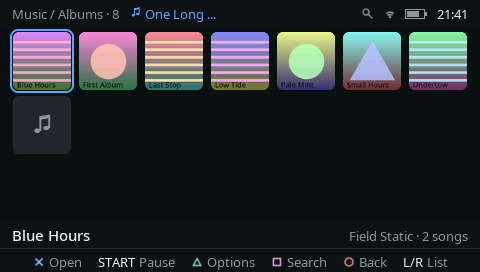
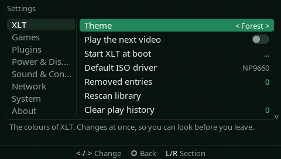

# XLT

A light, fast launcher for PSPs running the ARK custom firmware. It keeps the XMB's way of getting around in a
flatter, quieter look, and puts your games, music, videos, pictures and files one button away.

**[Watch XLT on YouTube](https://youtu.be/1EDtFNqxjh4)** · **[Download the latest release](https://github.com/boubounokefalos/xlt/releases/latest)**

> The games, songs and artwork in the screenshots and video are made up, drawn on a PC by XLT's own code.

## Features

- **Games:** ISO, CSO, ZSO, DAX, EBOOT, PS1 and homebrew, as a list or a grid, with per-game CPU speed, ISO driver,
  folders, favourites and play time. Copy a UMD to the Memory Stick as an ISO.
- **Music:** MP3, AAC/M4A and FLAC by artist, album or playlist, with covers, lyrics, a five-band equalizer,
  gapless albums, crossfades, even volume and a sleep timer. It keeps playing while you browse.
- **Video:** MP4 and PMF, with subtitles, audio tracks, resume and the next episode.
- **Pictures, files and text:** a file manager with ZIP unpacking and save data backup, a reader for text and PDF,
  and a text editor.
- **Web:** a simple browser for text, links, forms and pictures over secure connections (PSP-2000 or later).
- **Two layouts:** **Classic**, or **nMB**, a cross bar like a modern take on the PSP's own menu.
- **Eight colour themes**, interface sounds, a clock screensaver and a control center on SELECT.
- **Screenshots in games** (L+R+START) and **screen recording** in XLT (L+R+SELECT).
- **Settings in one place:** XLT's, ARK's and the PSP's own, plugins included, with an update check over Wi-Fi.
- **Longer battery life:** the CPU slows down when nothing is moving, and Wi-Fi turns off when unused.
- **Your language:** accented Latin, Greek, Cyrillic and Japanese in names, tags and text.
- **Crash log:** `SEPLUGINS/xltcrash.log` says what went wrong when a game, a plugin or XLT crashes.

**With [XLT Tool](https://github.com/boubounokefalos/xlt-tool) on your PC** (Linux and Windows), over the USB cable:

- **USB sync:** send videos, music, pictures, books and games while XLT keeps running, with no USB mode. Nothing
  half-written is ever left on the stick.
- **XLT Cast:** the game you're playing, live on the PC with its sound (L+R+SELECT in a game).
- **Internet over USB:** the PSP uses your PC's internet, with [USBNet](https://github.com/chriopter/pspkit-usbnet).
- **Updates over USB**, and your games, saves and play time in XLT Tool's library.

## New in 1.4.0

- **nMB**, a second layout: **Settings → XLT → Interface**.
- **Internet over the USB cable** with XLT Tool 1.3.0: **Settings → Network → Internet over USB**.
- **Update over USB** from XLT Tool, no Wi-Fi needed.
- **A text editor** in the Reader (△ → **Edit**).
- **Longer battery life**, a **crash log**, and **XLT Cast for PS1 games** (picture only for now).

Older versions: [releases](https://github.com/boubounokefalos/xlt/releases).

## Screenshots

| | |
|---|---|
|  |  |
| Home | The games list |
|  |  |
| The games as a grid | A game's options (△) |
|  |  |
| Music by album | Now Playing |
|  |  |
| The control center (SELECT) | Settings, trying a theme |

## Getting started

You need a PSP with **ARK-4 or ARK-5**.

1. Download `XLT-<version>.zip` from the [releases](https://github.com/boubounokefalos/xlt/releases/latest) and copy
   its `PSP` folder to the root of your Memory Stick, so you have `PSP/GAME/XLT/EBOOT.PBP`.
2. Start **XLT** from the XMB's Game menu. The first start looks through the stick for your games, music, videos
   and pictures (in `ISO/`, `PSP/GAME/`, `MUSIC/`, `VIDEO/` and `PICTURE/`).
3. Optional: **Settings → XLT → Start XLT at boot** makes your PSP start straight into XLT. Turning it off puts
   ARK's menu back.

**Updating:** **Settings → About → Check for updates** (Wi-Fi), **Update XLT on the PSP** in XLT Tool (USB), or
copy the new `EBOOT.PBP` over the old one. Your library and settings stay.

## Controls

| Where | Button | What it does |
|---|---|---|
| Anywhere | ✕ / ○ / △ / □ | Open / back / options / search |
| Anywhere | L / R | Switch category, or list ↔ grid |
| Anywhere | SELECT | Control center |
| Anywhere, and in games | L + R + START | Screenshot |
| Anywhere | L + R + SELECT | Record the screen (in a game with XLT Cast on: cast it) |
| Anywhere | HOME | Quit XLT? |
| Starting XLT | Hold L | Safe start: skip the library check |
| Now Playing | START | Equalizer |

## How it was made

XLT is **vibe-coded**: written with **Claude** (Anthropic's AI model) in [Claude Code](https://claude.com/claude-code).
The author decided what it should do and tested every build on a real PSP; Claude wrote the code, the tools, the
tests and the docs. It comes with no warranty, like any homebrew.

## For developers

XLT is C with the PSPSDK: `make` builds it (pspdev toolchain, Python 3 with Pillow), `make test` runs the host tests.
How every part works is in the **[developer docs](docs/Home.md)**.

## Credits

XLT is free software under the **GPL-3.0** (see [LICENSE](LICENSE)).

- **[psp5](https://github.com/08Weber/psp5)** by [08Weber](https://github.com/08Weber) (GPL-3.0): XLT adapts its MP3
  engine, system calls, UMD and boot paths, SETTINGS.TXT parser, graphics set-up, PMF video and network start-up.
  Special thanks to 08Weber.
- **Libraries:** [libcurl](https://curl.se/), [Mbed TLS](https://www.trustedfirmware.org/projects/mbed-tls/),
  [libjpeg](https://ijg.org/), [libpng](http://www.libpng.org/pub/png/libpng.html),
  [giflib](https://giflib.sourceforge.net/), [zlib](https://zlib.net/), [LZ4](https://github.com/lz4/lz4) and
  [PSPSDK](https://github.com/pspdev/pspsdk), each under its own license.
- **Built in:** the [Noto Sans](https://fonts.google.com/noto) fonts (SIL OFL 1.1) and Mozilla's CA certificates
  (MPL-2.0). Kanji come from the PSP's own font.
- **Works with:** [USBNet](https://github.com/chriopter/pspkit-usbnet) by chriopter (MIT), for internet over USB.
- **References:** [ARK](https://github.com/PSP-Archive/ARK-4)'s arkMenu, cooleyes' PMPlayer Advance, PPSSPP,
  psplibdoc, BetterBright and PSPLINK's `usbhostfs`.

Thanks to the ARK team and the PSP homebrew community. Everything in detail: **[License and credits](docs/Credits.md)**.

## Trademarks

PlayStation, PSP, UMD, XMB and the button symbols are trademarks of Sony Interactive Entertainment Inc.; Memory
Stick is a trademark of Sony Group Corporation; Claude and Claude Code are trademarks of Anthropic. XLT is an
independent, unofficial project, not affiliated with or endorsed by Sony or the ARK developers, and contains no
Sony software.
